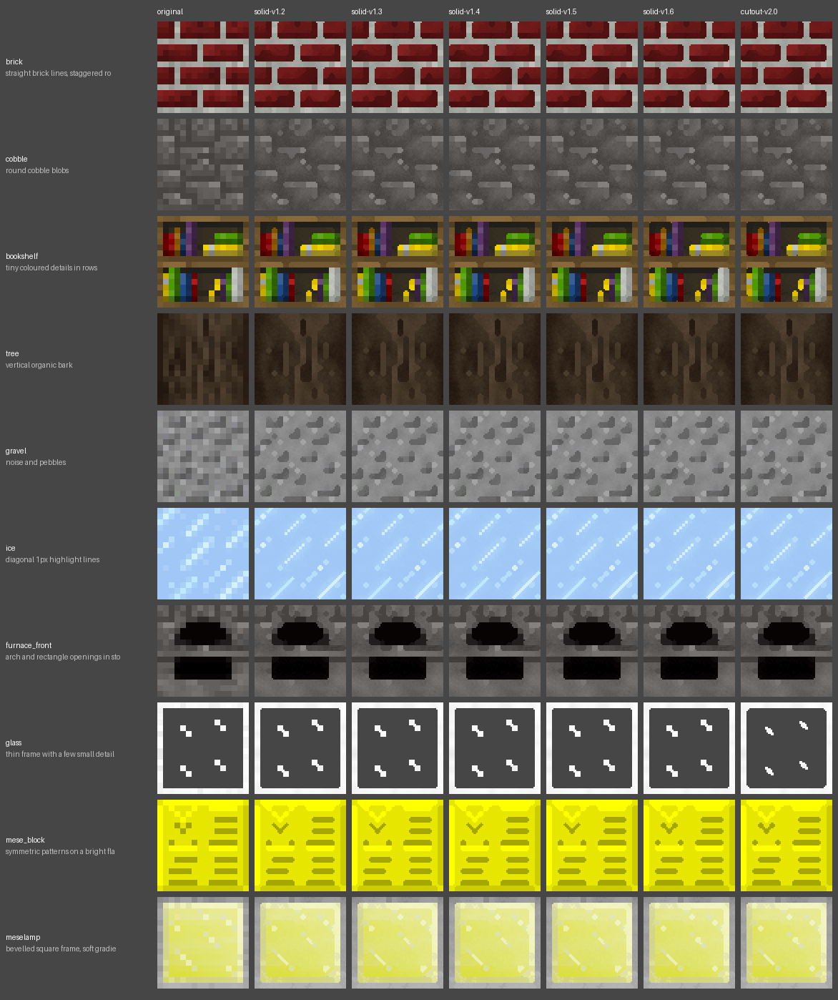
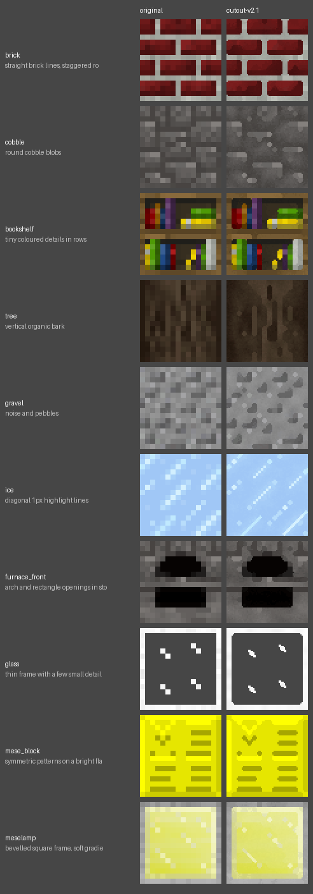
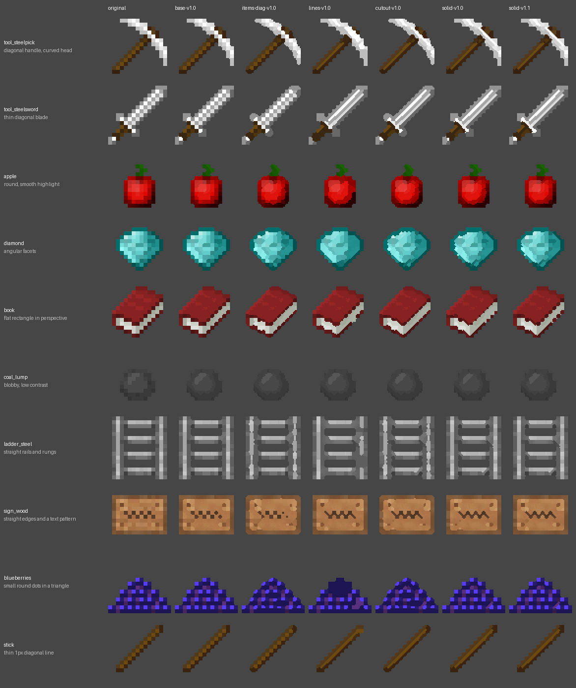
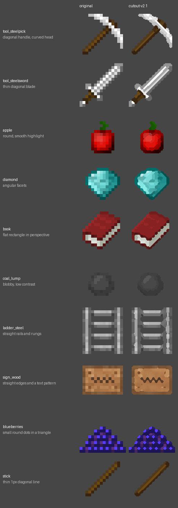

<!-- Generated by regen4x-docs: do not edit. Change presets.toml or the sample manifest and run it again. -->

# Presets: free samples (Minetest Game)

The sample textures are from [Minetest Game](https://github.com/luanti-org/minetest_game) (the `default` mod, textures by the Minetest Game contributors), licensed CC BY-SA 3.0, see [LICENSE-minetest_game.txt](../../samples/free/LICENSE-minetest_game.txt). The images in this folder are adaptations of them (upscaled versions) and are shared under the same license, CC BY-SA 3.0.

Generated by `regen4x-docs` from `presets.toml` and the sample manifest. Each preset page lists what it changes against its parent and shows the samples before and after.

## Presets

| preset | status | based on | summary |
|---|---|---|---|
| [base-v1.0](base-v1.0.md) | base | defaults | The baseline the other presets build on: flat colour areas upscaled with consistent rounded corners, fine grain added. It does not try to draw diagonals, so staircase edges stay staircases. |
| [items-diag-v1.0](items-diag-v1.0.md) | base | [base-v1.0](base-v1.0.md) | base-v1.0 plus smoother diagonals on item staircases. Not used on its own by any profile; cutout-v1.0 builds on it. |
| [lines-v1.0](lines-v1.0.md) | experimental | [base-v1.0](base-v1.0.md) | base-v1.0 plus the experimental line drawing for blocks with 1px diagonal lines (herringbone patterns, X-shaped seams). Experimental; known gap: it can melt busy patterns into blobs. |
| [cutout-v1.0](cutout-v1.0.md) | superseded | [items-diag-v1.0](items-diag-v1.0.md) | For cut-outs (items, leaves, plants): items-diag-v1.0 plus thin diagonal lines joined and drawn as continuous bands, opaque and semi-transparent pixels never share an area, 1px see-through diagonal gaps stay open, checkerboard rule off. |
| [solid-v1.0](solid-v1.0.md) | superseded | [base-v1.0](base-v1.0.md) | Solid-block preset: thin diagonal lines joined and drawn as bands, local staircase smoothing, bands clipped at line ends, weak soft band (0.3) so seam junctions stay sharp. |
| [solid-v1.1](solid-v1.1.md) | superseded | [solid-v1.0](solid-v1.0.md) | solid-v1.0 without widening the staircase window, so straight edges next to staircases stay square (e.g. a lamp's inner square). |
| [solid-v1.2](solid-v1.2.md) | superseded | [solid-v1.1](solid-v1.1.md) | solid-v1.1 with bands only for real lines (chain of 5+ px or contrast 0.18+), so faint short corner pairs on organic blocks are not drawn as dark dashes. |
| [solid-v1.3](solid-v1.3.md) | superseded | [solid-v1.2](solid-v1.2.md) | solid-v1.2 that also draws short seam pieces touching a long line (closes gaps in double herringbone). |
| [solid-v1.4](solid-v1.4.md) | superseded | [solid-v1.3](solid-v1.3.md) | solid-v1.3 that counts line length through crossings (the arms of an X) and extends line ends into a feature they run into. |
| [solid-v1.5](solid-v1.5.md) | superseded | [solid-v1.4](solid-v1.4.md) | solid-v1.4 where short pairs kept only for their contrast must be a thin 1px line on both pixels (fixes arch outlines; costs some smoothing on figure outlines). |
| [solid-v1.6](solid-v1.6.md) | stable | [solid-v1.5](solid-v1.5.md) | solid-v1.5 where lone 2px lines need contrast 0.26+ (no stray strokes on textures without real lines) and shapes are decided between colour groups first (no white bumps on signs). The solid preset the standard profile uses. |
| [cutout-v2.0](cutout-v2.0.md) | superseded | [cutout-v1.0](cutout-v1.0.md) | cutout-v1.0 plus the solid fixes (thinner soft band, band clipping, local staircase smoothing, real-lines-only rules, reach into same-colour features, colour groups that never change opacity). |
| [cutout-v2.1](cutout-v2.1.md) | stable | [cutout-v2.0](cutout-v2.0.md) | cutout-v2.0 where short (3px) lines inside the item count as real lines. The cutout preset the standard profile uses. |

## Profiles

Which preset a texture gets (first matching rule wins):

- `standard`: another name for `standard-r1`
- `standard-r1`: see-through textures -> cutout-v2.1, solid blocks -> solid-v1.6 (the shipping setup)
  - path */textures/block/* and see-through: [cutout-v2.1](cutout-v2.1.md) (keep opaque)
  - see-through: [cutout-v2.1](cutout-v2.1.md)
  - otherwise: [solid-v1.6](solid-v1.6.md)
- `legacy-cutout-v1-r1`: like standard-r1, but see-through textures use the older cutout-v1.0
  - path */textures/block/* and see-through: [cutout-v1.0](cutout-v1.0.md) (keep opaque)
  - see-through: [cutout-v1.0](cutout-v1.0.md)
  - path */textures/block/* and see-through: [cutout-v2.1](cutout-v2.1.md) (keep opaque)
  - see-through: [cutout-v2.1](cutout-v2.1.md)
  - otherwise: [solid-v1.6](solid-v1.6.md)

## Comparison sheets

### Blocks

Original, then base-v1.0, items-diag-v1.0, lines-v1.0, cutout-v1.0, solid-v1.0, solid-v1.1:

Original, then solid-v1.2, solid-v1.3, solid-v1.4, solid-v1.5, solid-v1.6, cutout-v2.0:

Original, then cutout-v2.1:

### Items

Original, then base-v1.0, items-diag-v1.0, lines-v1.0, cutout-v1.0, solid-v1.0, solid-v1.1:

Original, then solid-v1.2, solid-v1.3, solid-v1.4, solid-v1.5, solid-v1.6, cutout-v2.0:

Original, then cutout-v2.1:

## Samples

| texture | kind | shows | credit |
|---|---|---|---|
| brick | block | straight brick lines, staggered rows | Minetest Game contributors, CC BY-SA 3.0 |
| cobble | block | round cobble blobs | Minetest Game contributors, CC BY-SA 3.0 |
| bookshelf | block | tiny coloured details in rows | Minetest Game contributors, CC BY-SA 3.0 |
| tree | block | vertical organic bark | Minetest Game contributors, CC BY-SA 3.0 |
| gravel | block | noise and pebbles | Minetest Game contributors, CC BY-SA 3.0 |
| ice | block | diagonal 1px highlight lines | Minetest Game contributors, CC BY-SA 3.0 |
| furnace_front | block | arch and rectangle openings in stone | Minetest Game contributors, CC BY-SA 3.0 |
| glass | block | thin frame with a few small details | Minetest Game contributors, CC BY-SA 3.0 |
| mese_block | block | symmetric patterns on a bright flat colour | Minetest Game contributors, CC BY-SA 3.0 |
| meselamp | block | bevelled square frame, soft gradient | Minetest Game contributors, CC BY-SA 3.0 |
| tool_steelpick | item | diagonal handle, curved head | Minetest Game contributors, CC BY-SA 3.0 |
| tool_steelsword | item | thin diagonal blade | Minetest Game contributors, CC BY-SA 3.0 |
| apple | item | round, smooth highlight | Minetest Game contributors, CC BY-SA 3.0 |
| diamond | item | angular facets | Minetest Game contributors, CC BY-SA 3.0 |
| book | item | flat rectangle in perspective | Minetest Game contributors, CC BY-SA 3.0 |
| coal_lump | item | blobby, low contrast | Minetest Game contributors, CC BY-SA 3.0 |
| ladder_steel | item | straight rails and rungs | Minetest Game contributors, CC BY-SA 3.0 |
| sign_wood | item | straight edges and a text pattern | Minetest Game contributors, CC BY-SA 3.0 |
| blueberries | item | small round dots in a triangle | Minetest Game contributors, CC BY-SA 3.0 |
| stick | item | thin 1px diagonal line | Minetest Game contributors, CC BY-SA 3.0 |
