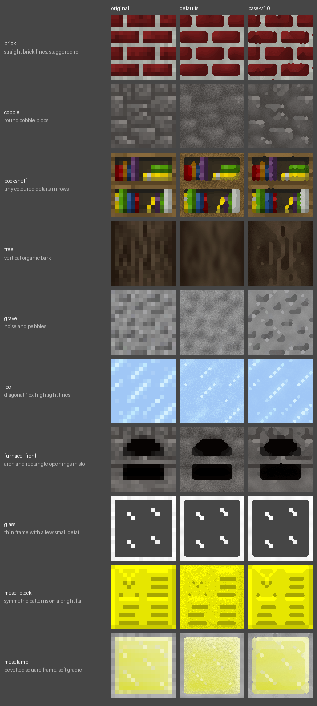
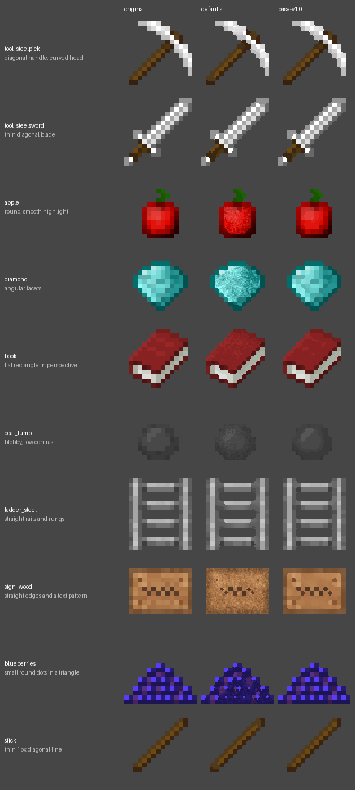
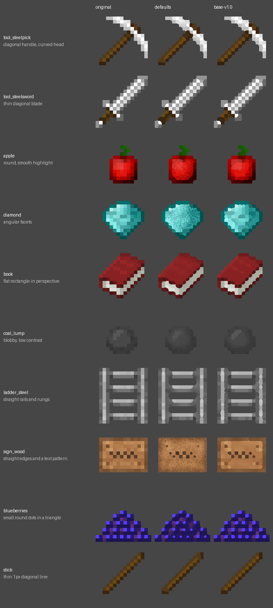

<!-- Generated by regen4x-docs: do not edit. Change presets.toml or the sample manifest and run it again. -->

# base-v1.0

The baseline the other presets build on: flat colour areas upscaled with consistent rounded corners, fine grain
added. It does not try to draw diagonals, so staircase edges stay staircases.

Status: **base** (a building block that other presets extend; not meant to be picked directly)  
Changes in this version: First version: flat colour areas with rounded corners and fine grain.  
Based on: the `RegenParams` defaults  
Built on this: [items-diag-v1.0](items-diag-v1.0.md), [lines-v1.0](lines-v1.0.md), [solid-v1.0](solid-v1.0.md)  

Not used by any built-in profile (pick it with `--blocks`, `--items` or `--use`).

## What it changes

Compared with defaults:

| option | defaults | base-v1.0 |
|---|---|---|
| `thr` | `0.13` | `0.07` |
| `mean_mode` | `False` | `True` |
| `shape_round` | `1.6` | `1.4` |
| `sharp_contrast` | `0.25` | `0.6` |
| `sharp_flat` | `0.06` | `0.04` |
| `grain` | `1.0` | `0.3` |
| `rules_items_only` | `False` | `True` |

## Examples

Original | defaults | base-v1.0.

### Blocks

x2: 16px to 32px


x4: 16px to 64px (default)


x8: 16px to 128px



### Items

x2: 16px to 32px


x4: 16px to 64px (default)



x8: 16px to 128px



## All settings

Every option that differs from the `RegenParams` default, and the preset that set it:

```text
thr = 0.07   [base-v1.0]
mean_mode = True   [base-v1.0]
shape_round = 1.4   [base-v1.0]
sharp_contrast = 0.6   [base-v1.0]
sharp_flat = 0.04   [base-v1.0]
grain = 0.3   [base-v1.0]
rules_items_only = True   [base-v1.0]
```
