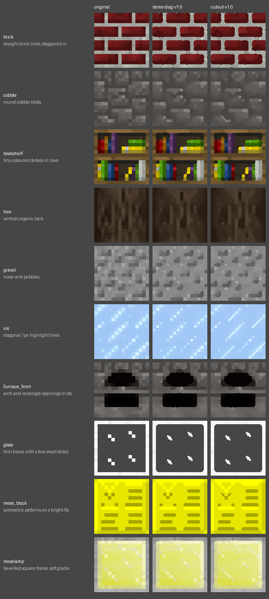
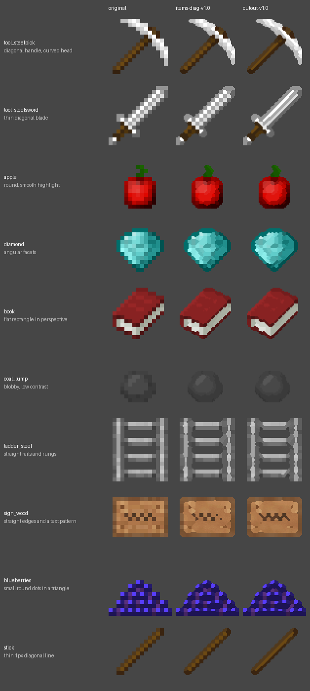

<!-- Generated by regen4x-docs: do not edit. Change presets.toml or the sample manifest and run it again. -->

# cutout-v1.0

For cut-outs (items, leaves, plants): items-diag-v1.0 plus thin diagonal lines joined and drawn as continuous bands,
opaque and semi-transparent pixels never share an area, 1px see-through diagonal gaps stay open, checkerboard rule off.

Status: **superseded** (replaced by a newer version, kept so older packs can be rebuilt)  
Changes in this version: First cut-out preset: thin diagonal lines as bands, alpha split, open diagonal gaps, checkerboard rule off.  
Based on: [items-diag-v1.0](items-diag-v1.0.md)  
Built on this: [cutout-v2.0](cutout-v2.0.md)  

Used by:
- profile `legacy-cutout-v1-r1`: path */textures/block/* and see-through, then restores lost opaque pixels
- profile `legacy-cutout-v1-r1`: see-through

## What it changes

Compared with items-diag-v1.0:

| option | items-diag-v1.0 | cutout-v1.0 |
|---|---|---|
| `diag_join` | `False` | `True` |
| `alpha_split` | `False` | `True` |
| `join_thin_only` | `False` | `True` |
| `keep_gaps` | `False` | `True` |
| `keep_dither` | `True` | `False` |
| `line_field` | `False` | `True` |
| `line_strength` | `1.05` | `0.6` |
| `line_contrast` | `0.1` | `0.05` |

## Examples

Original | items-diag-v1.0 | cutout-v1.0.

### Blocks

x2: 16px to 32px


x4: 16px to 64px (default)


x8: 16px to 128px



### Items

x2: 16px to 32px


x4: 16px to 64px (default)



x8: 16px to 128px


## All settings

Every option that differs from the `RegenParams` default, and the preset that set it:

```text
thr = 0.07   [base-v1.0]
mean_mode = True   [base-v1.0]
diag_join = True   [cutout-v1.0]
alpha_split = True   [cutout-v1.0]
join_thin_only = True   [cutout-v1.0]
shape_round = 1.4   [base-v1.0]
sharp_contrast = 0.6   [base-v1.0]
sharp_flat = 0.04   [base-v1.0]
diag_items = True   [items-diag-v1.0]
diag_sigma = 2.0   [items-diag-v1.0]
keep_gaps = True   [cutout-v1.0]
grain = 0.3   [base-v1.0]
rules_items_only = True   [base-v1.0]
keep_dither = False   [cutout-v1.0]
line_field = True   [cutout-v1.0]
line_strength = 0.6   [cutout-v1.0]
line_contrast = 0.05   [cutout-v1.0]
```
