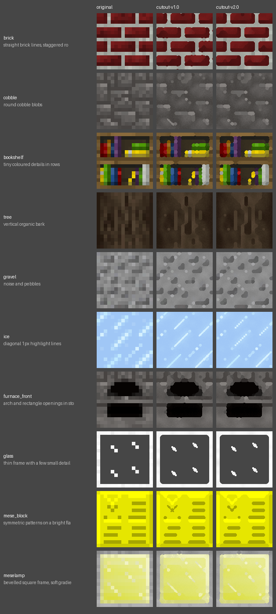
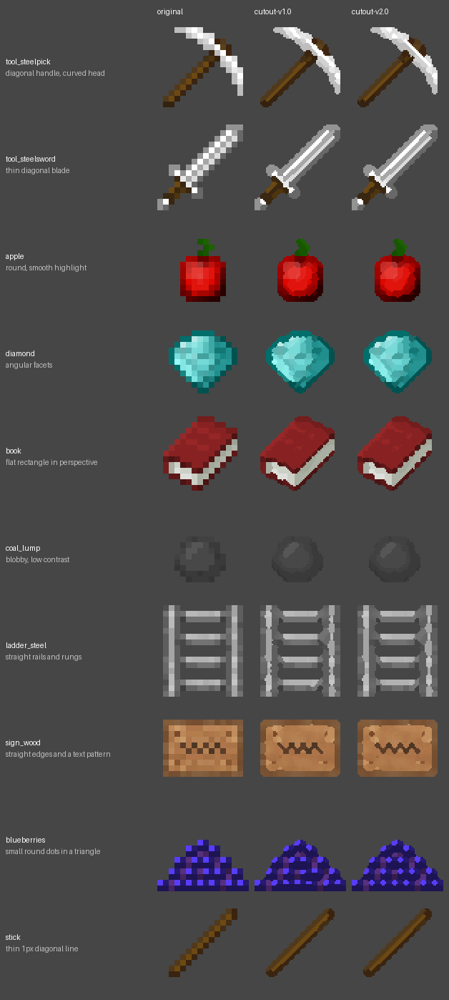

<!-- Generated by regen4x-docs: do not edit. Change presets.toml or the sample manifest and run it again. -->

# cutout-v2.0

cutout-v1.0 plus the solid fixes (thinner soft band, band clipping, local staircase smoothing,
real-lines-only rules, reach into same-colour features, colour groups that never change opacity).

Status: **superseded** (replaced by a newer version, kept so older packs can be rebuilt)  
Changes in this version: Takes over the solid fixes up to solid-v1.6 (thinner soft band, band clipping, real-lines-only rules, ...).  
Based on: [cutout-v1.0](cutout-v1.0.md)  
Built on this: [cutout-v2.1](cutout-v2.1.md)  

Not used by any built-in profile (pick it with `--blocks`, `--items` or `--use`).

## What it changes

Compared with cutout-v1.0:

| option | cutout-v1.0 | cutout-v2.0 |
|---|---|---|
| `shape_groups` | `0` | `0.2` |
| `stair_local` | `False` | `True` |
| `stair_grow` | `True` | `False` |
| `line_strength` | `0.6` | `0.3` |
| `line_clip` | `False` | `True` |
| `line_min_len` | `0` | `5` |
| `line_strong` | `1.0` | `0.18` |
| `line_attach` | `False` | `True` |
| `line_thru` | `False` | `True` |
| `line_reach` | `False` | `True` |
| `strong_thin` | `False` | `True` |
| `single_con` | `1.0` | `0.26` |

## Examples

Original | cutout-v1.0 | cutout-v2.0.

### Blocks

x2: 16px to 32px


x4: 16px to 64px (default)


x8: 16px to 128px



### Items

x2: 16px to 32px


x4: 16px to 64px (default)



x8: 16px to 128px


## All settings

Every option that differs from the `RegenParams` default, and the preset that set it:

```text
thr = 0.07   [base-v1.0]
mean_mode = True   [base-v1.0]
diag_join = True   [cutout-v1.0]
alpha_split = True   [cutout-v1.0]
join_thin_only = True   [cutout-v1.0]
shape_round = 1.4   [base-v1.0]
sharp_contrast = 0.6   [base-v1.0]
sharp_flat = 0.04   [base-v1.0]
shape_groups = 0.2   [cutout-v2.0]
diag_items = True   [items-diag-v1.0]
diag_sigma = 2.0   [items-diag-v1.0]
stair_local = True   [cutout-v2.0]
stair_grow = False   [cutout-v2.0]
keep_gaps = True   [cutout-v1.0]
grain = 0.3   [base-v1.0]
rules_items_only = True   [base-v1.0]
keep_dither = False   [cutout-v1.0]
line_field = True   [cutout-v1.0]
line_strength = 0.3   [cutout-v2.0]
line_contrast = 0.05   [cutout-v1.0]
line_clip = True   [cutout-v2.0]
line_min_len = 5   [cutout-v2.0]
line_strong = 0.18   [cutout-v2.0]
line_attach = True   [cutout-v2.0]
line_thru = True   [cutout-v2.0]
line_reach = True   [cutout-v2.0]
strong_thin = True   [cutout-v2.0]
single_con = 0.26   [cutout-v2.0]
```
