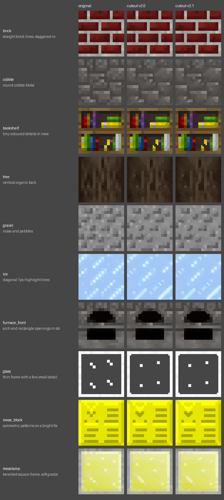
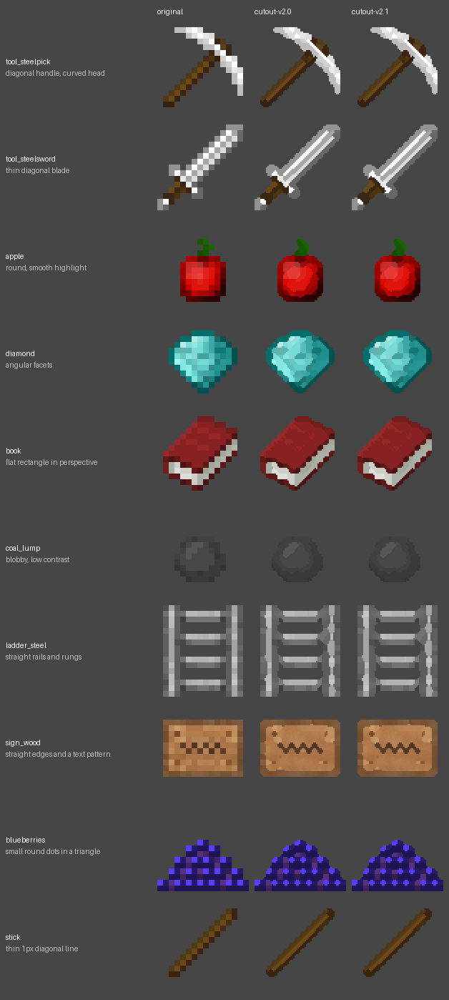
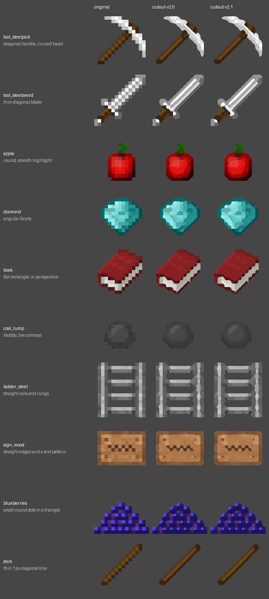

<!-- Generated by regen4x-docs: do not edit. Change presets.toml or the sample manifest and run it again. -->

# cutout-v2.1

cutout-v2.0 where short (3px) lines inside the item count as real lines. The cutout preset the standard profile uses.

Status: **stable** (ready to use; the newest profile release ships it)  
Changes in this version: Short (3px) lines inside the item count as real lines.  
Based on: [cutout-v2.0](cutout-v2.0.md)  

Used by:
- profile `standard-r1`: path */textures/block/* and see-through, then restores lost opaque pixels
- profile `standard-r1`: see-through
- profile `legacy-cutout-v1-r1`: path */textures/block/* and see-through, then restores lost opaque pixels
- profile `legacy-cutout-v1-r1`: see-through

## What it changes

Compared with cutout-v2.0:

| option | cutout-v2.0 | cutout-v2.1 |
|---|---|---|
| `inner_min_len` | `0` | `3` |

## Examples

Original | cutout-v2.0 | cutout-v2.1.

### Blocks

x2: 16px to 32px



x4: 16px to 64px (default)


x8: 16px to 128px


### Items

x2: 16px to 32px


x4: 16px to 64px (default)



x8: 16px to 128px



## All settings

Every option that differs from the `RegenParams` default, and the preset that set it:

```text
thr = 0.07   [base-v1.0]
mean_mode = True   [base-v1.0]
diag_join = True   [cutout-v1.0]
alpha_split = True   [cutout-v1.0]
join_thin_only = True   [cutout-v1.0]
shape_round = 1.4   [base-v1.0]
sharp_contrast = 0.6   [base-v1.0]
sharp_flat = 0.04   [base-v1.0]
shape_groups = 0.2   [cutout-v2.0]
diag_items = True   [items-diag-v1.0]
diag_sigma = 2.0   [items-diag-v1.0]
stair_local = True   [cutout-v2.0]
stair_grow = False   [cutout-v2.0]
keep_gaps = True   [cutout-v1.0]
grain = 0.3   [base-v1.0]
rules_items_only = True   [base-v1.0]
keep_dither = False   [cutout-v1.0]
line_field = True   [cutout-v1.0]
line_strength = 0.3   [cutout-v2.0]
line_contrast = 0.05   [cutout-v1.0]
line_clip = True   [cutout-v2.0]
line_min_len = 5   [cutout-v2.0]
line_strong = 0.18   [cutout-v2.0]
line_attach = True   [cutout-v2.0]
line_thru = True   [cutout-v2.0]
line_reach = True   [cutout-v2.0]
strong_thin = True   [cutout-v2.0]
single_con = 0.26   [cutout-v2.0]
inner_min_len = 3   [cutout-v2.1]
```
