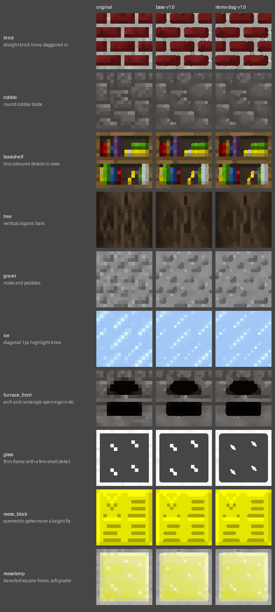
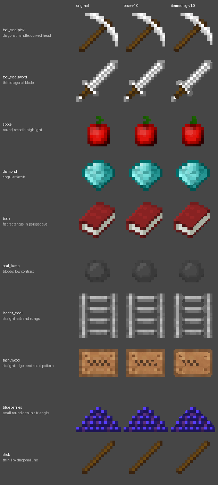
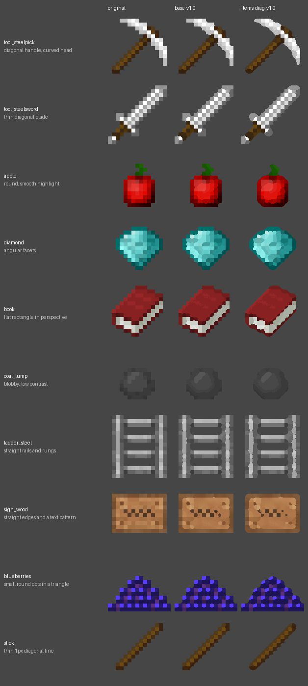

<!-- Generated by regen4x-docs: do not edit. Change presets.toml or the sample manifest and run it again. -->

# items-diag-v1.0

base-v1.0 plus smoother diagonals on item staircases. Not used on its own by any profile; cutout-v1.0 builds on it.

Status: **base** (a building block that other presets extend; not meant to be picked directly)  
Changes in this version: First version: smoother diagonals on item staircases.  
Based on: [base-v1.0](base-v1.0.md)  
Built on this: [cutout-v1.0](cutout-v1.0.md)  

Not used by any built-in profile (pick it with `--blocks`, `--items` or `--use`).

## What it changes

Compared with base-v1.0:

| option | base-v1.0 | items-diag-v1.0 |
|---|---|---|
| `diag_items` | `False` | `True` |
| `diag_sigma` | `2.5` | `2.0` |

## Examples

Original | base-v1.0 | items-diag-v1.0.

### Blocks

x2: 16px to 32px


x4: 16px to 64px (default)


x8: 16px to 128px



### Items

x2: 16px to 32px



x4: 16px to 64px (default)


x8: 16px to 128px



## All settings

Every option that differs from the `RegenParams` default, and the preset that set it:

```text
thr = 0.07   [base-v1.0]
mean_mode = True   [base-v1.0]
shape_round = 1.4   [base-v1.0]
sharp_contrast = 0.6   [base-v1.0]
sharp_flat = 0.04   [base-v1.0]
diag_items = True   [items-diag-v1.0]
diag_sigma = 2.0   [items-diag-v1.0]
grain = 0.3   [base-v1.0]
rules_items_only = True   [base-v1.0]
```
