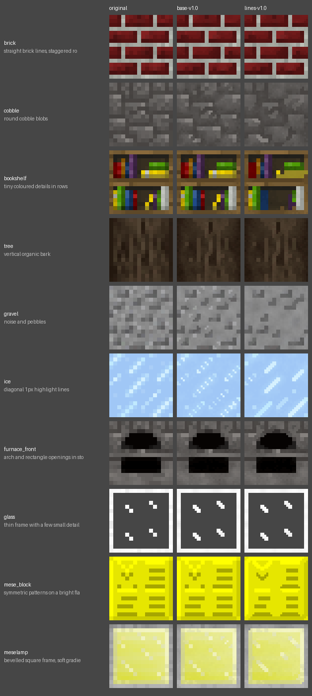
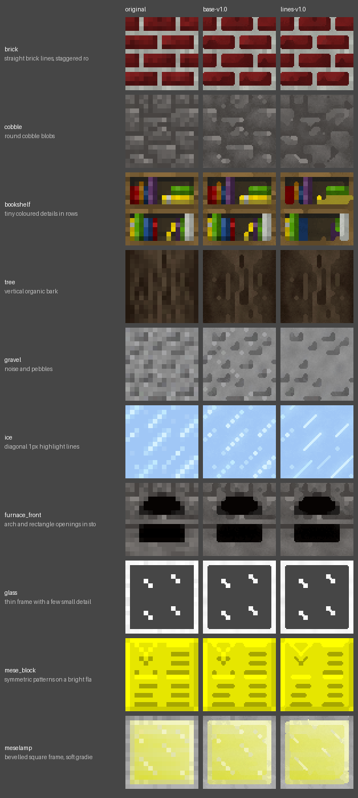
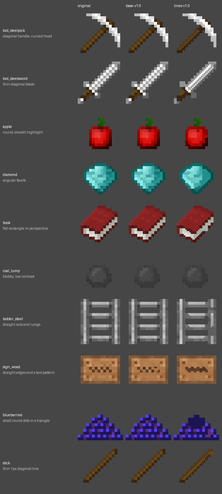
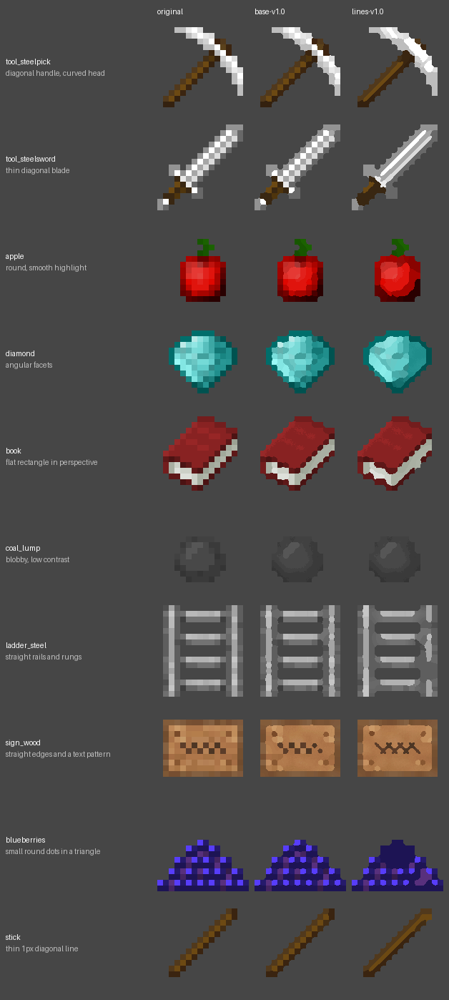

<!-- Generated by regen4x-docs: do not edit. Change presets.toml or the sample manifest and run it again. -->

# lines-v1.0

base-v1.0 plus the experimental line drawing for blocks with 1px diagonal lines (herringbone patterns, X-shaped seams).
Experimental; known gap: it can melt busy patterns into blobs.

Status: **experimental** (may change or be removed; not used by any profile)  
Changes in this version: First version: line drawing for 1px diagonal lines on blocks.  
Based on: [base-v1.0](base-v1.0.md)  

Not used by any built-in profile (pick it with `--blocks`, `--items` or `--use`).

## What it changes

Compared with base-v1.0:

| option | base-v1.0 | lines-v1.0 |
|---|---|---|
| `diag_join` | `False` | `True` |
| `dither_min` | `2` | `3` |
| `line_field` | `False` | `True` |
| `line_strength` | `1.05` | `0.6` |
| `line_aa_merge` | `False` | `True` |
| `line_contrast` | `0.1` | `0.05` |
| `line_neighbours_diag` | `False` | `True` |

## Examples

Original | base-v1.0 | lines-v1.0.

### Blocks

x2: 16px to 32px



x4: 16px to 64px (default)



x8: 16px to 128px


### Items

x2: 16px to 32px



x4: 16px to 64px (default)


x8: 16px to 128px



## All settings

Every option that differs from the `RegenParams` default, and the preset that set it:

```text
thr = 0.07   [base-v1.0]
mean_mode = True   [base-v1.0]
diag_join = True   [lines-v1.0]
shape_round = 1.4   [base-v1.0]
sharp_contrast = 0.6   [base-v1.0]
sharp_flat = 0.04   [base-v1.0]
grain = 0.3   [base-v1.0]
rules_items_only = True   [base-v1.0]
dither_min = 3   [lines-v1.0]
line_field = True   [lines-v1.0]
line_strength = 0.6   [lines-v1.0]
line_aa_merge = True   [lines-v1.0]
line_contrast = 0.05   [lines-v1.0]
line_neighbours_diag = True   [lines-v1.0]
```
