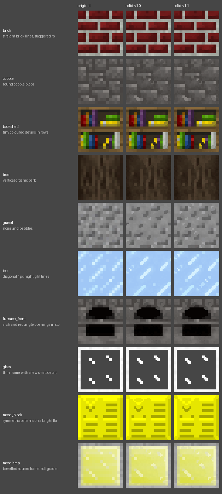
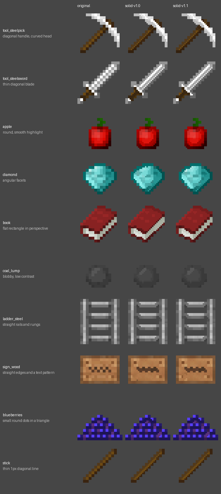
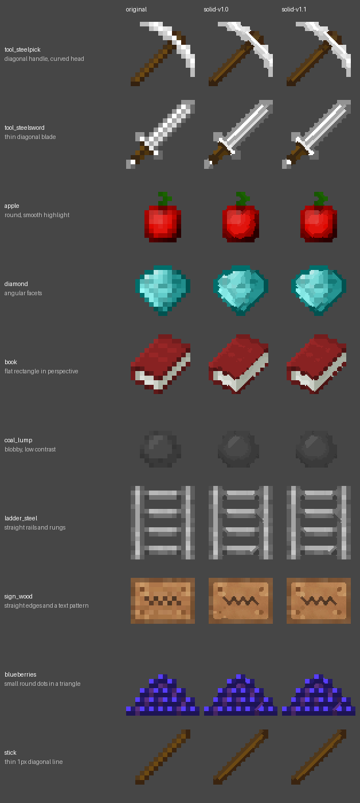
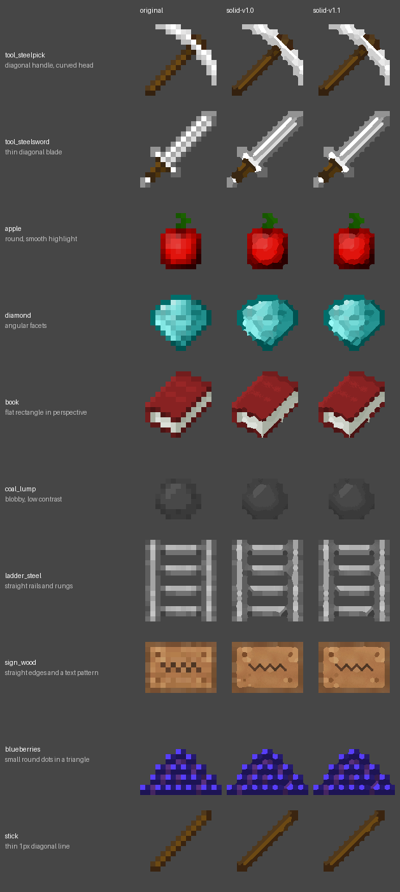

<!-- Generated by regen4x-docs: do not edit. Change presets.toml or the sample manifest and run it again. -->

# solid-v1.1

solid-v1.0 without widening the staircase window, so straight edges next to staircases stay square (e.g. a lamp's inner square).

Status: **superseded** (replaced by a newer version, kept so older packs can be rebuilt)  
Changes in this version: Staircase window is not widened, so straight edges next to staircases stay square.  
Based on: [solid-v1.0](solid-v1.0.md)  
Built on this: [solid-v1.2](solid-v1.2.md)  

Not used by any built-in profile (pick it with `--blocks`, `--items` or `--use`).

## What it changes

Compared with solid-v1.0:

| option | solid-v1.0 | solid-v1.1 |
|---|---|---|
| `stair_grow` | `True` | `False` |

## Examples

Original | solid-v1.0 | solid-v1.1.

### Blocks

x2: 16px to 32px



x4: 16px to 64px (default)


x8: 16px to 128px


### Items

x2: 16px to 32px



x4: 16px to 64px (default)



x8: 16px to 128px



## All settings

Every option that differs from the `RegenParams` default, and the preset that set it:

```text
thr = 0.07   [base-v1.0]
mean_mode = True   [base-v1.0]
diag_join = True   [solid-v1.0]
join_thin_only = True   [solid-v1.0]
shape_round = 1.4   [base-v1.0]
sharp_contrast = 0.6   [base-v1.0]
sharp_flat = 0.04   [base-v1.0]
stair_local = True   [solid-v1.0]
stair_grow = False   [solid-v1.1]
grain = 0.3   [base-v1.0]
rules_items_only = True   [base-v1.0]
keep_dither = False   [solid-v1.0]
line_field = True   [solid-v1.0]
line_strength = 0.3   [solid-v1.0]
line_contrast = 0.05   [solid-v1.0]
line_clip = True   [solid-v1.0]
```
