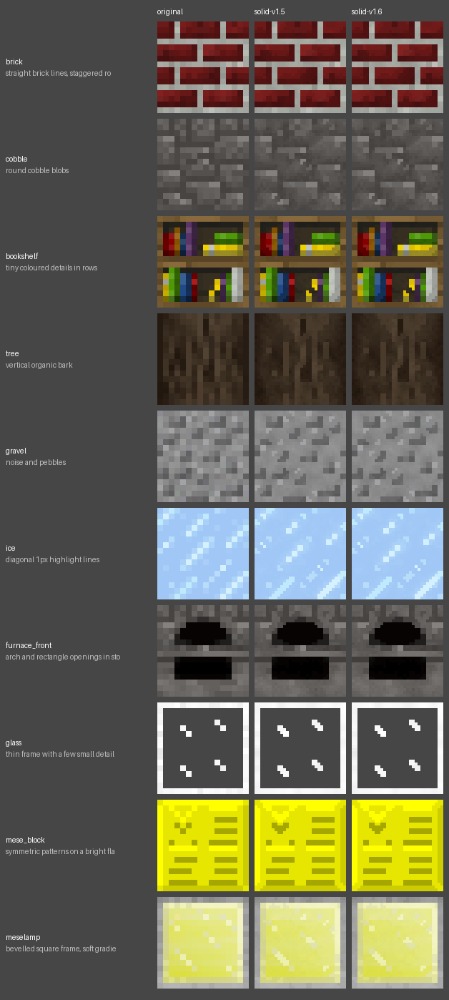
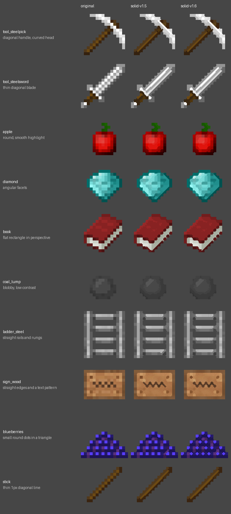

<!-- Generated by regen4x-docs: do not edit. Change presets.toml or the sample manifest and run it again. -->

# solid-v1.6

solid-v1.5 where lone 2px lines need contrast 0.26+ (no stray strokes on textures without real lines) and shapes are decided
between colour groups first (no white bumps on signs). The solid preset the standard profile uses.

Status: **stable** (ready to use; the newest profile release ships it)  
Changes in this version: Lone 2px lines need contrast 0.26+; shapes are decided between colour groups first (no bumps on signs).  
Based on: [solid-v1.5](solid-v1.5.md)  

Used by:
- profile `standard-r1`: otherwise
- profile `legacy-cutout-v1-r1`: otherwise

## What it changes

Compared with solid-v1.5:

| option | solid-v1.5 | solid-v1.6 |
|---|---|---|
| `shape_groups` | `0` | `0.2` |
| `single_con` | `1.0` | `0.26` |

## Examples

Original | solid-v1.5 | solid-v1.6.

### Blocks

x2: 16px to 32px



x4: 16px to 64px (default)


x8: 16px to 128px


### Items

x2: 16px to 32px


x4: 16px to 64px (default)



x8: 16px to 128px


## All settings

Every option that differs from the `RegenParams` default, and the preset that set it:

```text
thr = 0.07   [base-v1.0]
mean_mode = True   [base-v1.0]
diag_join = True   [solid-v1.0]
join_thin_only = True   [solid-v1.0]
shape_round = 1.4   [base-v1.0]
sharp_contrast = 0.6   [base-v1.0]
sharp_flat = 0.04   [base-v1.0]
shape_groups = 0.2   [solid-v1.6]
stair_local = True   [solid-v1.0]
stair_grow = False   [solid-v1.1]
grain = 0.3   [base-v1.0]
rules_items_only = True   [base-v1.0]
keep_dither = False   [solid-v1.0]
line_field = True   [solid-v1.0]
line_strength = 0.3   [solid-v1.0]
line_contrast = 0.05   [solid-v1.0]
line_clip = True   [solid-v1.0]
line_min_len = 5   [solid-v1.2]
line_strong = 0.18   [solid-v1.2]
line_attach = True   [solid-v1.3]
line_thru = True   [solid-v1.4]
line_reach = True   [solid-v1.4]
strong_thin = True   [solid-v1.5]
single_con = 0.26   [solid-v1.6]
```
